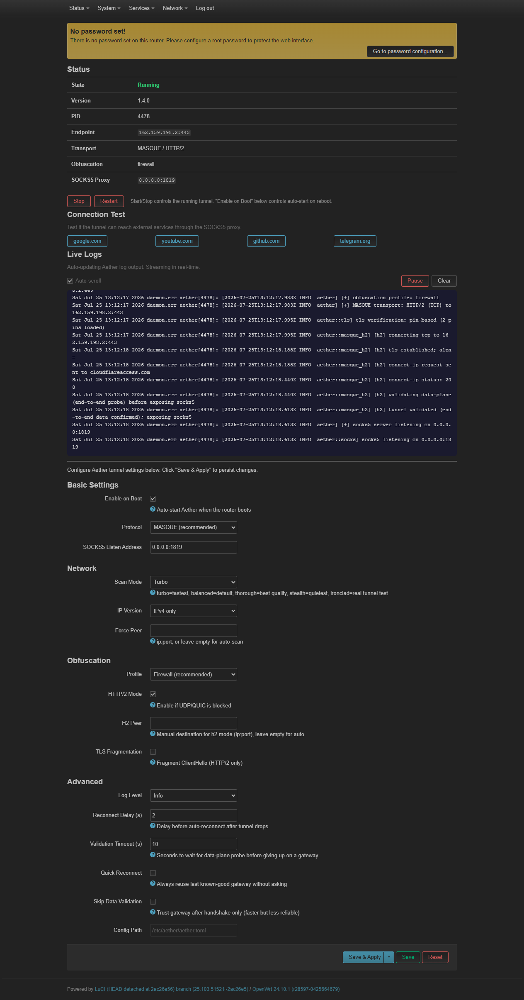

[فارسی](README-fa.md) | [English](README.md)

Quick guide: [English client guide](CLIENT-GUIDE.en.md) | [راهنمای فارسی](CLIENT-GUIDE.fa.md)

# Aether OpenWrt Client

**Client release: v0.10.0**

OpenWrt integration for [Aether](https://github.com/CluvexStudio/Aether) — a censorship circumvention client.

**Aether is developed by [CluvexStudio](https://github.com/CluvexStudio). This repo provides an OpenWrt installer and LuCI web interface.**

## Requirements

- **OpenWrt 24.10 or newer** (musl libc; uses apk on 25.12+, opkg on 24.10 and older)
- Tested on OpenWrt 25.12.5 (x86_64)
- ~10 MB free disk space
- Architectures: x86_64, arm64 (aarch64), armv7

## Install (one line)

```sh
wget -qO /tmp/aether-install.sh https://raw.githubusercontent.com/moein8668-git/aether-openwrt-client/main/install.sh && chmod +x /tmp/aether-install.sh && /tmp/aether-install.sh --start
```

During install you will be asked:

- **Aether core version**: the newest stable releases from v1.5.0 onward are
  shown (up to five). Press Enter for the v2.4.0 default, select a listed
  release, or type a valid v1.5.0-or-newer `vX.Y.Z` version.
- **Install curl?** Defaults to **Yes**. curl enables LuCI connection tests and end-to-end watchdog recovery. Use `--no-curl` to skip it; the tunnel will work, but the watchdog will not start.

## What it does

1. Auto-detects your router architecture (x86_64, arm64, armv7)
2. Downloads the latest official Aether binary from [CluvexStudio/Aether releases](https://github.com/CluvexStudio/Aether/releases)
3. Installs the Aether service (procd), CLI tool, and LuCI web interface
4. Downloads support files (init script, LuCI app, CLI, config) from GitHub
5. Verifies the downloaded Aether release with its SHA-256 checksum

## Features

- **CLI**: `aether-ctl start|stop|restart|status|show|log|test <host>|check-ip|check-tor` (`tor-ip` alias, `Tor: true|false IP:`), `check-psiphon` (`psiphon-ip` alias), `aether-ctl change-version <vX.Y.Z>`, `aether-ctl passwall <…>`, performance/gool options, and v2 MIM, QUIC v2, ECH, Tor, Psiphon, and exit-location settings. `set` validates values (`tor_bind` as `ip:port`, `tor_dir` absolute, `reverse` only over MASQUE/MIM or modern gool, `exit_loc` as `!IR`/`DE,SE`); `status` and `show` report effective settings, e.g. `balanced (stored firewall)`.
- **LuCI**: Services -> Aether
  - Status table (state, version, endpoint, transport, SOCKS5 address, configured Tor/Psiphon state, and exit policy)
  - Start / Stop / Restart buttons
  - Connection test buttons with accurate millisecond timing, Public IP geolocation check, Tor exit check (when Tor is enabled), and Psiphon exit check (when Psiphon is enabled)
  - Real-time live logs (auto-updating, pause/resume, auto-scroll)
  - Passwall2 integration: warning when Passwall2 proxies router-local traffic (`localhost_proxy=1`), one-click disable, and one-click creation of a Passwall2 socks node pointing at Aether
  - Full configuration (protocol, scan mode, obfuscation, HTTP/2, etc.)
  - Custom Command section: generated/manual core command line with the current procd command preview
- **Recovery watchdog**: verifies traffic through SOCKS5 and restarts only a stuck core process after repeated failures
- **Upstream proxy chaining** (core v1.7+): dial out through another SOCKS5/HTTP proxy before reaching Cloudflare (passed via `--upstream`)
- **ECH** (core v1.9+): optional encrypted ClientHello configuration
- **Core v2**: MASQUE-in-MASQUE, user-selectable QUIC v2 opener, and Tor modes for Tor-enabled core packages
- **Core v2.1**: exit-country filtering (default `!IR`), Psiphon three modes, Tor relays/HTTP, optional stats logging, and the full `pt/` tree (lyrebird + Psiphon)
- **Zero Trust**: headless organization enrollment with a Cloudflare Access service token
- **Service**: procd integration, auto-start on boot
- **Architecture**: x86_64, arm64, armv7 (musl static builds)

## Install options

```sh
/tmp/aether-install.sh                 # install only
/tmp/aether-install.sh --start         # install and start now
/tmp/aether-install.sh --force-config  # overwrite existing config
/tmp/aether-install.sh --no-curl       # skip curl installation prompt
/tmp/aether-install.sh --version v1.5.0 --start
/tmp/aether-install.sh --non-interactive --start  # use v2.4.0, no prompts
```

## Uninstall

```sh
wget -qO /tmp/aether-uninstall.sh https://raw.githubusercontent.com/moein8668-git/aether-openwrt-client/main/uninstall.sh
chmod +x /tmp/aether-uninstall.sh
/tmp/aether-uninstall.sh           # remove application files; keep config and identities
/tmp/aether-uninstall.sh --purge   # also permanently remove config and identity data
```

## CLI commands

```sh
aether-ctl start
aether-ctl stop
aether-ctl restart
aether-ctl status
aether-ctl show
aether-ctl log              # show recent logs
aether-ctl test google.com  # test connection through tunnel (needs curl)
aether-ctl check-ip         # check public IP, country, and latency (ipwho.is)
aether-ctl check-tor        # check Tor exit IP and IsTor status (v2.0.0+, Tor modes)
aether-ctl check-psiphon    # check Psiphon exit IP (v2.1.0+, Psiphon modes)
aether-ctl passwall status            # show Passwall2 state and matching nodes
aether-ctl passwall localhost off     # stop Passwall2 proxying router-local traffic
aether-ctl passwall add-node          # create a socks node -> Aether (e.g. 127.0.0.1:1819)
aether-ctl version
aether-ctl update                       # fetch latest client updater, keep v2.4.0 default
aether-ctl change-version v1.5.0 --start
aether-ctl update --version v1.5.0 --start
aether-ctl set tor_mode tunnel            # Tor through WARP (v2.0.0+ Tor build)
aether-ctl set exit_loc '!IR'             # refuse Iranian WARP exits (v2.1.0+)
aether-ctl set psiphon_mode tunnel        # Psiphon through WARP (v2.1.0+)
aether-ctl set command_mode manual        # use your own core arguments
aether-ctl set custom_command '--bind 0.0.0.0:1819 --wg'  # space-separated args
aether-ctl set upstream_proxy socks5://192.168.1.9:1082  # chain via another proxy (v1.7+)
aether-ctl set gool_mode classic          # WireGuard-in-WireGuard gool (v2.3+; default modern)
aether-ctl register all                   # register identities without starting (v2.3+)
aether-ctl set masque_sni www.cloudflare.com  # MASQUE TLS server name (v2.4+)
aether-ctl set scan_mode verified         # quiet scan (v2.4+)
```

## Updates

`aether-ctl update` downloads the latest `update.sh` from this repository and
re-runs the installer. Existing `/etc/config/aether` and valid identities in
`/etc/aether` are preserved unless `--force-config` is supplied. The core
archive is always verified against the matching upstream SHA-256 file.

## Core compatibility

Client release **v0.10.0** supports Aether core **v1.5.0 and newer** and defaults
to **v2.4.0**. The client detects the installed core before starting the
service and before rendering the LuCI form, then applies the matching
capability profile:

- **Core v1.5.x:** uses only v1.5-supported arguments. HTTP CONNECT, the MASQUE
  startup deadline, and core log-level controls are hidden, rejected by the
  CLI, and never passed to the core.
- **Core v1.6.x:** uses the v1.6 capability profile (HTTP CONNECT proxy,
  MASQUE startup deadline, log levels).
- **Core v1.7.x:** adds upstream proxy chaining (`upstream_proxy` UCI option).
- **Core v1.8.x:** adds the performance profile (`perf_profile` UCI option;
  auto-detected by `install.sh` or `aether-ctl auto-perf`, editable as `low`/`medium`/`high`).
- **Core v1.9.x and newer:** adds dual-hop WARP-in-WARP endpoints
  (`wiw_outer` / `wiw_inner` UCI options; empty = core scans both hops) and
  optional ECH (`ech`, unset = core default).
- **Core v2.0.0:** adds MASQUE-in-MASQUE (`mim` with `mim_*`
  endpoints), the user-selectable QUIC v2 opener, and Tor controls. Tor needs
  a Core build compiled with the Tor feature; the client gates these controls
  by Core version but does not detect that build feature in advance. Routing
  rules, custom DNS, firewall marks, and resource controls remain deliberately
  unexposed.
- **Core v2.1.0 and newer:** adds exit-country filtering (`exit_loc`, default
  `!IR`), Psiphon (`psiphon_mode` tunnel/reverse/only), Tor relay/HTTP extras,
  optional `--stats` syslog, and installs the full core `pt/` tree (lyrebird
  plus the Psiphon console client). `firewall`/`gfw` MASQUE profiles are real
  as of 2.1.0 (v2.0 advertised them but fell through to balanced).
- **Core v2.3.0 and newer:** `--gool` is now **modern gool** (WireGuard inside a
  MASQUE tunnel); the old WireGuard-in-WireGuard transport is `--gool-classic`.
  The new `gool_mode` option (`modern`/`classic`) selects between them: fresh
  installs use `modern`, and `install.sh` keeps existing gool configs on
  `classic` so they behave as before. Modern gool accepts the MASQUE options
  (`http2_mode`, `fragment_tls`, `ech`, ...), a `gool_peer` hop, and carries
  reverse Tor/Psiphon. Also adds `aether-ctl register`, `tls_verify`, and
  `ech_dns`/`ech_domain`. The `wiw_*` hop options apply to classic gool only.
- **Core v2.4.0 and newer:** adds `masque_sni`, WARP API reachability
  (`api_address`/`api_host`/`api_sni`), TLS fingerprint tuning (`tls_*` and the
  `disable_*`/`enable_*` switches), and the `verified` scan mode (the new name of
  `stealth`). `--fragment` now also covers the WARP API calls on every transport,
  so `fragment_tls` is honoured for WireGuard and classic gool too (core default
  size `8-16`, which is the new client default). A `upstream_proxy` the core cannot
  dial is fatal in 2.4, so the client validates the value before starting
  (`aether-ctl set` rejects it; `init.d` refuses to start with a clear log line).
  The SOCKS5 port is open from the moment the core starts and clients queue until
  the tunnel validates, so readiness is read from the log (`masque tunnel validated`
  / `socks5 server listening on`), not from the port.

LuCI displays the client version and detected core version separately. To
switch the installed core without changing the client integration, use:

```sh
aether-ctl change-version v1.5.0 --start
aether-ctl change-version v1.6.0 --start
aether-ctl change-version v1.7.0 --start
aether-ctl change-version v1.9.0 --start
aether-ctl change-version v2.0.0 --start
aether-ctl change-version v2.1.0 --start
aether-ctl change-version v2.4.0 --start
```

The preserved UCI configuration may contain options unavailable to the
selected core; those values remain stored for upgrades but are marked inactive
and are not passed to incompatible cores. Routing rules, custom DNS, TLS
groups, and per-protocol identity paths remain core-only options.

## LuCI Web Interface

After install, open your router web UI -> **Services -> Aether**



- Status table (state, version, endpoint, transport, configured Tor/Psiphon state, exit policy)
- Start / Stop / Restart buttons
- Connection test buttons (google.com, youtube.com, github.com, telegram.org) with accurate ms timing, Public IP geolocation, Tor exit check, and Psiphon exit check
- Custom Command section (current generated command preview / manual core arguments)
- Real-time live logs (auto-updating every 2 seconds, no manual refresh needed)
- Pause/Resume log streaming
- Auto-scroll toggle
- Clear logs button
- Passwall2 Integration (below Advanced settings): warning when Passwall2 proxies router-local traffic, one-click disable, one-click creation of a socks node pointing at Aether
- Full configuration (protocol, scan mode, obfuscation, HTTP/2, etc.)

After an update, if the new LuCI page or fields do not appear, use `Ctrl+F5`,
an incognito/private window, or a different browser. Browser JavaScript caches
can keep the previous interface.

## Manual update (from your PC)

If you have the repo cloned locally and want to push updated files to your router without going through GitHub:

```sh
# Create a tarball of the files directory
cd aether-openwrt-client
tar czf /tmp/aether-files.tar.gz files/

# Transfer to router (OpenWrt doesn't have scp server, use wget from router)
# On your PC, serve the file temporarily:
python -m http.server 8888 --directory /tmp

# On the router:
wget -O /tmp/aether-files.tar.gz http://<your-pc-ip>:8888/aether-files.tar.gz
tar xzf /tmp/aether-files.tar.gz -C /
/etc/init.d/aether restart
/etc/init.d/rpcd restart
```

Or just re-run the install script (it always fetches the latest files from GitHub):

```sh
wget -qO /tmp/aether-install.sh https://raw.githubusercontent.com/moein8668-git/aether-openwrt-client/main/install.sh && chmod +x /tmp/aether-install.sh && /tmp/aether-install.sh --start
```

## Using with Passwall 2 (Transparent Proxy)

If you are using **Passwall 2** (or similar transparent proxy plugins) to route your entire network traffic through Aether's SOCKS5 proxy (`127.0.0.1:1819`), **you must disable "Localhost Proxy" (Router Self-Proxy)** in Passwall 2's **Main Switch** settings.

### Why is this necessary?
- **The Routing Loop Problem:** When Localhost Proxy is enabled, Passwall intercepts *all* network traffic originating from the router itself (via the firewall's `OUTPUT` chain). Since Aether runs locally on the router, Passwall captures Aether's own outbound connection and scanning packets (UDP 443 / UDP 2408 destined for Cloudflare edge servers) and loops them back into Passwall $\rightarrow$ Aether SOCKS5. Because Aether cannot send handshake packets directly to the internet, it gets trapped in a loop and fails to connect.
- **What happens when you disable Localhost Proxy?**
  1. **Aether Core connects directly:** Outbound traffic from local router processes bypasses Passwall and goes straight through your WAN interface, allowing Aether to discover endpoints and establish the tunnel with Cloudflare without interference.
  2. **LAN clients remain fully proxied:** All traffic from your connected LAN devices (phones, PCs, smart TVs) is still intercepted by Passwall (via the `PREROUTING` chain) and routed transparently through Aether's SOCKS5 tunnel.

### Built-in integration (v0.5.1)

The client automates this setup so the manual steps above are usually not
needed:

- The **Passwall2 Integration** section in LuCI (below *Advanced settings*)
  shows the current state, warns when Localhost Proxy is enabled, and offers a
  one-click disable plus one-click creation of a Passwall2 socks node pointing
  at Aether.
- On the CLI, `aether-ctl passwall status` reports the state,
  `aether-ctl passwall localhost off|on` toggles Localhost Proxy, and
  `aether-ctl passwall add-node` creates a single canonical node named
  `aether_node` targeting Aether's current listen address.
- If an existing Aether-related node points at a different address/port, no
  duplicate is created; both CLI and LuCI print manual repair instructions
  instead (edit that node in Services -> Passwall2 -> Nodes, or delete it and
  create it again).

## Notes

- Requires OpenWrt 24.10+ with musl libc (apk on 25.12+, opkg on older)
- Fresh installs bind SOCKS5 to `0.0.0.0:1819` so LAN clients can use it.
  SOCKS5 has no authentication; protect the port with firewall rules or change
  the listen address to `127.0.0.1:1819` for router-local use.
- `curl` is optional (asked during install, defaults to Yes). It enables LuCI connection tests and the data-plane recovery watchdog.
- Zero Trust service-token secrets are kept in the root-only UCI config and redacted from CLI and service command output.
- Tor (core v2 Tor builds): controls are shown by Core version, but a Core package must also include Tor support. If `:1820` listens but Tor never connects, check `logread -e aether` for filesystem-permission errors — the service repairs `/` and `/etc` ownership/modes automatically on start. Verify with `aether-ctl check-tor` (expect `Tor: true IP: …`). Core v2.1 also fetches bridgedb through the WARP tunnel and can use onionoo relays (`tor_relays`).
- Exit location (core v2.1): `exit_loc=!IR` refuses Iranian WARP exits before SOCKS opens and rechecks every minute; `off` (or an empty value) stores the literal `off` and disables the check — it is not re-enabled by the `!IR` install default. The watchdog keeps its 180s startup grace floor only while a policy is set.
- Psiphon (core v2.1): `psiphon_mode` is `off`/`tunnel`/`reverse`/`only`, same shape as Tor. Reverse requires a MASQUE-side carrier (MASQUE, MIM, or modern gool). `only` cannot be combined with `tor_mode=only`. Verify with `aether-ctl check-psiphon`. Needs the Psiphon binary in `/usr/bin/pt`.
- Manual command mode bypasses every UCI option (including Tor): paste full commands or bare arguments; a leading `/usr/bin/aether(-run)` is stripped automatically. Probes read the manual binds; `check-tor` refuses fast when `--tor` is absent.
- See [CLIENT-GUIDE.en.md](CLIENT-GUIDE.en.md) for the settings, protocols,
  watchdog behavior, Zero Trust configuration, and troubleshooting.
- This project is not affiliated with CluvexStudio
- This project is mostly vide-coded.

## License

MIT — this installer and LuCI app only. Aether itself is AGPL-3.0.

